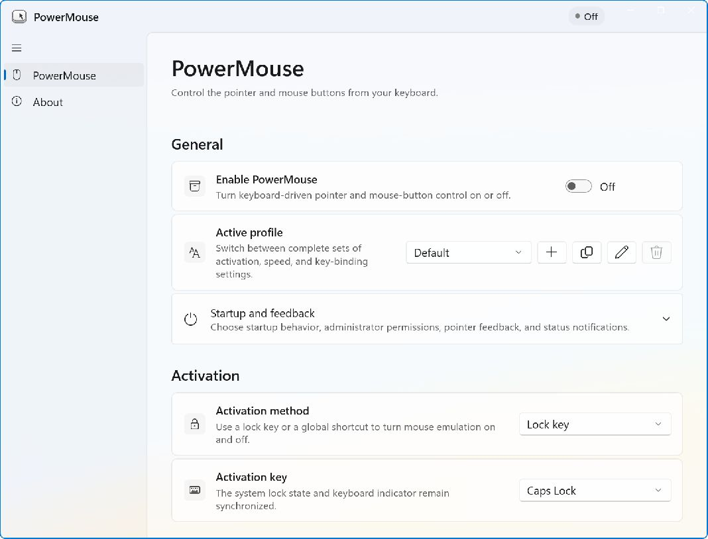

<p align="center">
  
</p>

<h1 align="center">PowerMouse</h1>

<p align="center">
  Keep your hands on the keyboard. Take the pointer with you.
</p>

<p align="center">
  <a href="https://github.com/agsoto/PowerMouse/actions/workflows/build.yml"></a>
  <a href="CHANGELOG.md"></a>
  
  <a href="LICENSE"></a>
</p>

<p align="center">
  <a href="https://github.com/agsoto/PowerMouse/releases">Download</a> ·
  <a href="#what-it-does">Features</a> ·
  <a href="#default-controls">Controls</a> ·
  <a href="CHANGELOG.md">Changelog</a>
</p>

PowerMouse turns your keyboard into a mouse: move, click, drag, and scroll without reaching for another device. Set up the keys and movement that suit you, then keep it out of the way in the notification area.

Useful for keyboard-focused workflows, repetitive pointer tasks, and switching between typing and precise movement.



## What it does

- **Move your way.** Eight-direction control, alternate speed, and optional acceleration curves.
- **Click, hold, and drag.** Left, right, and middle buttons, plus adjustable scrolling.
- **Keep separate profiles.** Switch bindings and motion settings for different workflows.
- **Jump to controls.** Experimental Mouse Hints labels visible controls with short codes you can type.
- **Work with elevated apps.** Restart as administrator or opt into elevated startup.
- **Stay local.** No account, service, or telemetry. Settings and logs stay on your PC.

## Install

The stable release targets **Windows 11 x64**.

1. Download `PowerMouse-1.0.0-win-x64.zip` from [GitHub Releases](https://github.com/agsoto/PowerMouse/releases).
2. Extract it to a permanent folder.
3. Run `PowerMouse.exe`.

Keep the extracted files together. The app is self-contained; no separate .NET installation is needed. Archives are unsigned, so Windows may show an unknown-publisher warning.

Select the tray icon to open settings. Right-click it to toggle mouse control or exit.

Each packaged archive has a `.sha256` file. To verify a download:

```powershell
Get-FileHash .\PowerMouse-1.0.0-win-x64.zip -Algorithm SHA256
```

Compare the result with the hash in the accompanying file.

## Default controls

| Action | Key |
|---|---|
| Activate or deactivate | Scroll Lock |
| Move | Numeric keypad 1–4 and 6–9 |
| Left button | Numeric keypad 0 |
| Right button | Numeric keypad Enter |
| Middle button | Numeric keypad 5 |
| Scroll up | Numeric keypad Divide |
| Scroll down | Numeric keypad Multiply |
| Alternate speed | Left Shift |
| Show Mouse Hints | Ctrl + Shift + Space |

Hold a mouse-button key while moving to drag. All bindings can be changed in settings. Profiles store activation, movement, and button settings.

## Mouse Hints

Type a displayed code to move to a target and optionally click it. Hold the configured action modifier while typing the final key to invert the click setting.

Press Escape, click elsewhere, switch windows, or press the shortcut again to dismiss hints. You can disable Mouse Hints independently of mouse control.

Detection uses Windows UI Automation and OCR. Coverage varies by application; OCR can label text that is not clickable.

## Administrator mode

Open **General → Startup and feedback** and choose **Restart as administrator** to control elevated apps, such as Task Manager. Approve the Windows prompt with the same account. Canceling leaves PowerMouse running normally.

The restart applies only to the current session. To use administrator permissions on future launches, enable **Always run as administrator** while elevated. With **Start with Windows** also enabled, a scheduled task launches PowerMouse elevated at sign-in without another prompt.

To return to normal permissions, disable **Always run as administrator**, exit, and relaunch. `PowerMouse.exe --dont-elevate` skips automatic elevation for one launch. If you move the installation folder, run the app as administrator once to update its startup task.

## Known limitations

- The pointer indicator may disappear behind Start and other Windows shell panels, including in administrator mode.
- Protected apps, games, remote sessions, and secure desktops may reject synthesized input.
- Mouse Hints is experimental; custom controls and inaccessible windows may have incomplete coverage.

## Settings and logs

PowerMouse does not send telemetry.

- Settings: `%LOCALAPPDATA%\PowerMouse\settings.json`
- Logs: `%LOCALAPPDATA%\PowerMouse\Logs`

Use **About → Open logs folder** when reporting a problem. Review logs for private information before sharing them.

## Build from source

Requires Windows and the .NET SDK specified in [global.json](global.json).

```powershell
./scripts/build.ps1 -Platform x64
```

This runs the tests and publishes to `artifacts/PowerMouse-x64`. Run `./scripts/package.ps1 -Platform x64` to create the versioned ZIP and checksum. ARM64 builds are available with `-Platform ARM64`; Windows 10 and ARM64 are outside the stable support scope.

To build and install locally:

```powershell
./scripts/install-dev.ps1
```

Run it again to update. The default location is `%LOCALAPPDATA%\Programs\PowerMouse`; settings are preserved and the previous build is kept in `PowerMouse.previous`. Close an elevated instance from the tray before updating.

Uninstall with `./scripts/uninstall-dev.ps1`. Add `-PurgeData` to remove settings and logs.

## Contributing

Bug reports, feature ideas, and focused pull requests are welcome. Start with [Contributing](CONTRIBUTING.md).

Developer guides: [Architecture](docs/architecture.md) · [Mouse Hints detection](docs/click-hints-detection.md) · [Testing](docs/testing.md).

## Security

Report vulnerabilities through [private vulnerability reporting](https://github.com/agsoto/PowerMouse/security/advisories/new). See [SECURITY.md](SECURITY.md).

## License

[MIT](LICENSE).
